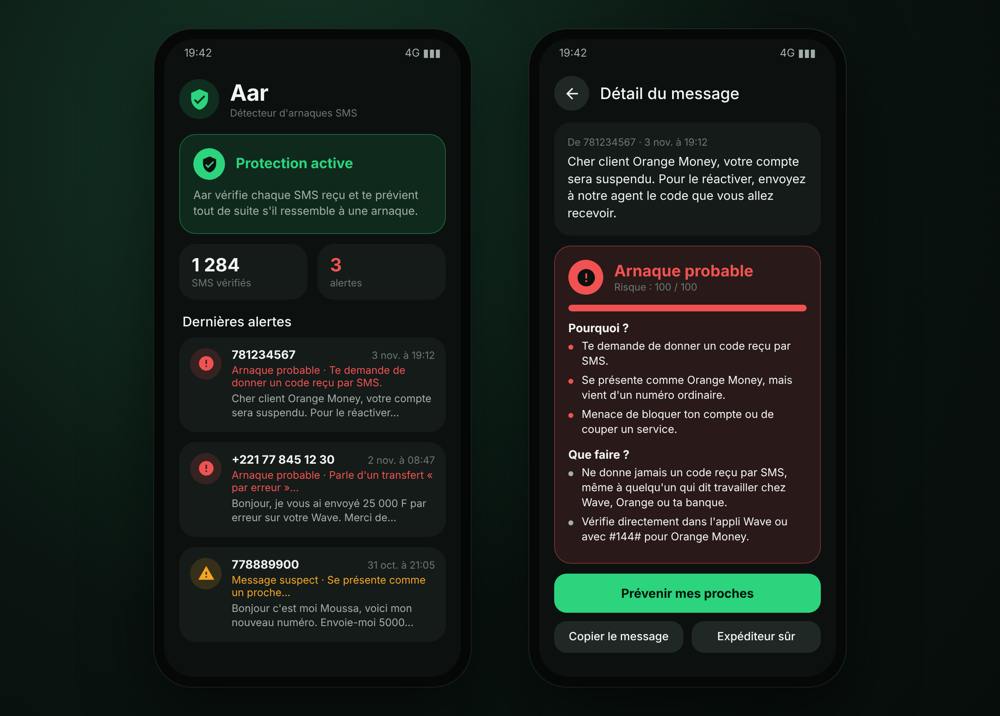

# Aar 🛡️

**Détecteur d'arnaques SMS pour Android.** « Aar » veut dire « protéger » en wolof.

Aar vérifie chaque SMS reçu et te prévient tout de suite s'il ressemble à une arnaque : faux transfert Wave ou Orange Money « envoyé par erreur », demande de code, faux agent, lien piège, faux gain… Tout se passe sur le téléphone : l'appli n'a pas accès à Internet.



## Fonctionnalités

- **Alerte immédiate** : une notification dès qu'un SMS douteux arrive, avec un score de risque sur 100 et les raisons.
- **Analyse de la boîte** : Aar passe en revue tes 300 derniers SMS et liste ceux à surveiller.
- **Vérifier un message** : colle un SMS ou un message WhatsApp, ou partage-le vers Aar depuis une autre appli.
- **Explications et conseils** : pour chaque message, pourquoi il est suspect et quoi faire.
- **Prévenir mes proches** : partage l'alerte sur WhatsApp en un geste.
- **Expéditeurs sûrs** : si Aar se trompe, marque l'expéditeur et ses messages ne seront plus signalés.

## Ce qu'Aar repère

| Arnaque | Exemple |
|---|---|
| Faux transfert « par erreur » | « Je vous ai envoyé 25 000 F par erreur, renvoyez-les svp », aussi en wolof (« ci njuumte… delloo ma ko ») |
| Faux avis de transfert | « Orange Money : vous avez reçu 50 000 F » envoyé depuis un numéro ordinaire |
| Demande de code | « Envoie-moi le code que tu viens de recevoir » |
| Faux agent | « Je suis agent Wave, pour vérifier votre compte… » |
| Code USSD piège | « Composez #144\*1\*1\*77…\*20000# pour activer votre bonus » |
| Lien piège | lien raccourci, adresse IP, faux site du type `wave-sn-securite.com` |
| Faux gain | tombola, tirage au sort, « frais de dossier » à payer d'abord |
| Faux proche | « C'est moi, j'ai changé de numéro, envoie-moi 20 000 » |
| Argent facile | prêt sans garantie, « doublez votre argent », emploi en ligne |
| Menaces | « votre compte sera bloqué », « votre compteur sera coupé » |

Chaque indice ajoute des points. À partir de 30 sur 100, le message est **suspect** ; à partir de 60, c'est une **arnaque probable**. Aar reconnaît aussi les signes des vrais messages officiels (nom d'expéditeur, « ne le partagez avec personne ») pour éviter les fausses alertes.

## Installation

1. Télécharge le fichier `.apk` de la dernière version dans [Releases](../../releases).
2. Ouvre-le sur le téléphone et autorise l'installation d'applis de source inconnue si Android le demande.
3. Ouvre Aar et touche **Activer la protection** pour autoriser les SMS et les notifications.

Si Android refuse l'autorisation SMS en parlant de **paramètre restreint** : Paramètres → Applications → Aar → menu ⋮ → **Autoriser les paramètres restreints**, puis réessaie.

Téléphones Android 8 ou plus récents.

## Versions

| Version | Nouveautés |
|---|---|
| [1.0](../../releases/tag/v1.0) | Première version : alertes, analyse de la boîte, vérification d'un message |

Le détail est dans [`CHANGELOG.md`](CHANGELOG.md).

## Confidentialité

Aar ne demande pas l'accès à Internet : les SMS sont analysés sur le téléphone et ne sont envoyés nulle part. L'historique des alertes reste dans l'appli et s'efface à tout moment.

Aar est une aide, pas une garantie : il peut laisser passer une arnaque ou signaler un vrai message. Dans le doute, ne donne aucun code et vérifie directement auprès de ton opérateur.

## Construire l'APK

Pas de Gradle : `build.sh` enchaîne aapt2, javac, D8, zipalign et apksigner avec le SDK Android (`ANDROID_HOME`). La clé de signature n'est pas publiée dans ce dépôt ; son mot de passe se donne dans la variable `KS_PASS`.

À chaque envoi sur GitHub, le workflow [`apk.yml`](.github/workflows/apk.yml) lance les tests du moteur puis construit l'APK signé ; publier une version dans Releases y joint l'APK. Le workflow [`emulateur.yml`](.github/workflows/emulateur.yml) installe l'appli sur un émulateur Android 14, lui envoie un faux SMS d'arnaque et un vrai message, et vérifie qu'une seule alerte part.

Le moteur de détection (`src/sn/aar/core`) est en Java pur et se teste sur ordinateur :

```
javac -encoding UTF-8 -d /tmp/aar src/sn/aar/core/*.java desktop-test/TestDetecteur.java
java -cp /tmp/aar TestDetecteur
```
